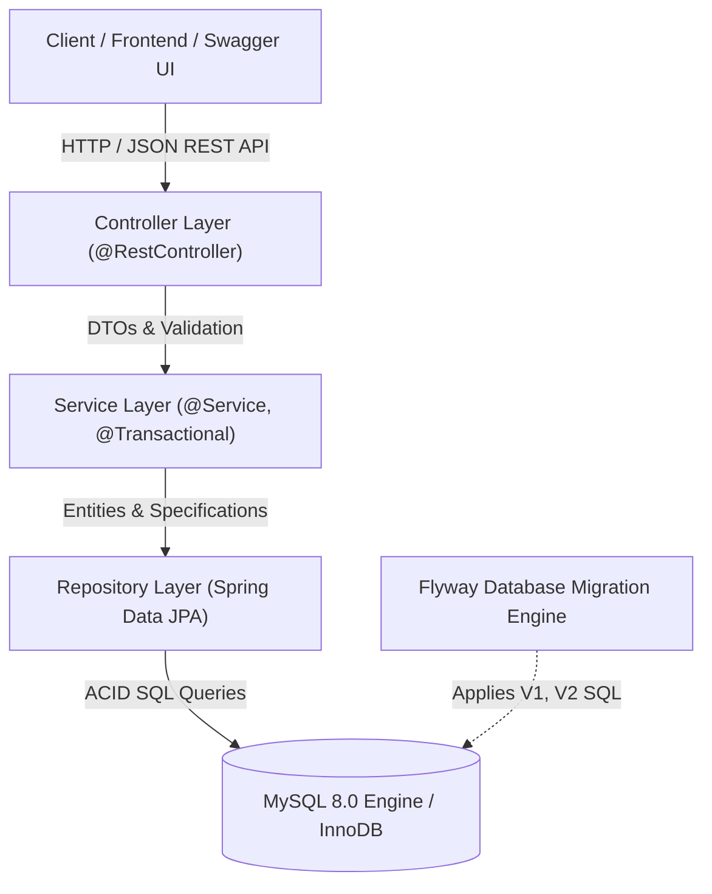

# ShopSphere — Full-Stack E-commerce & Inventory Management Platform

ShopSphere is an enterprise-grade full-stack e-commerce and inventory management application built with **Spring Boot 3.4**, **Java 21/24**, **Spring Data JPA / Hibernate**, **MySQL 8.0**, and **Flyway Database Migrations**, designed with strict layered architecture, zero client-side pricing trust, concurrency safety, and professional API standards.

---

## 1. High-Level Architecture



---

## 2. Tech Stack

- **Backend**: Java 21 LTS (`--release 21`), Spring Boot 3.4.3, Spring Web, Spring Security, Spring Data JPA, Hibernate 6.6, Jakarta Bean Validation.
- **Database**: MySQL 8.0 (InnoDB engine), Flyway migrations.
- **Testing**: JUnit 5, Mockito, Spring Boot Test, MockMvc, AssertJ, H2 in-memory test database.
- **API Documentation**: Springdoc OpenAPI 3.0 / Swagger UI (`/swagger-ui.html`).
- **Build Tool**: Maven 3.9+.

---

## 3. Implemented REST APIs (Phase 1 Foundation)

### Product Catalog APIs (`/api/products`)
| Method | Endpoint | Description | Status Code |
|---|---|---|---|
| `GET` | `/api/products` | Paginated product browsing with search query, category filter, price bounds, in-stock filter, and multi-field sorting | `200 OK` |
| `GET` | `/api/products/{id}` | Get product by numeric ID | `200 OK` / `404 Not Found` |
| `GET` | `/api/products/slug/{slug}` | Get product by SEO URL slug | `200 OK` / `404 Not Found` |
| `GET` | `/api/products/sku/{sku}` | Get product by unique SKU | `200 OK` / `404 Not Found` |
| `GET` | `/api/products/low-stock` | Get products where stock $\le$ threshold | `200 OK` |
| `POST` | `/api/products` | Create product with validation (unique SKU/slug, positive prices) | `201 Created` / `400` / `409` |
| `PUT` | `/api/products/{id}` | Update product details | `200 OK` / `400` / `404` / `409` |
| `DELETE` | `/api/products/{id}` | Soft-deactivate product (`isActive = false`) to preserve order history | `204 No Content` / `404` |

### Category APIs (`/api/categories`)
| Method | Endpoint | Description | Status Code |
|---|---|---|---|
| `GET` | `/api/categories` | Flat list of active categories | `200 OK` |
| `GET` | `/api/categories/hierarchy` | Root categories with nested active subcategories | `200 OK` |
| `GET` | `/api/categories/{id}` | Get category by ID | `200 OK` / `404 Not Found` |
| `GET` | `/api/categories/slug/{slug}` | Get category by URL slug | `200 OK` / `404 Not Found` |
| `POST` | `/api/categories` | Create category (auto-generates slug, checks uniqueness) | `201 Created` / `400` / `409` |
| `PUT` | `/api/categories/{id}` | Update category | `200 OK` / `400` / `404` / `409` |
| `DELETE` | `/api/categories/{id}` | Soft-deactivate category | `204 No Content` / `404` |

---

## 4. Local Setup & Execution

### Prerequisites
- JDK 21 or 24 installed
- Apache Maven 3.9+
- MySQL 8.0 Server running on port 3306

### Database Setup
Flyway automatically creates the schema and seed data when starting with the `dev` profile. Create the database:
```sql
CREATE DATABASE IF NOT EXISTS shopsphere_db CHARACTER SET utf8mb4 COLLATE utf8mb4_unicode_ci;
```

### Running the Application
```bash
# Run with local MySQL dev profile
mvn spring-boot:run "-Dspring-boot.run.profiles=dev"
```

### Accessing Interactive API Documentation
- **Swagger UI**: [http://localhost:8080/swagger-ui.html](http://localhost:8080/swagger-ui.html)
- **OpenAPI 3.0 JSON**: [http://localhost:8080/v3/api-docs](http://localhost:8080/v3/api-docs)

### Executing Automated Tests
```bash
# Run full test suite (36 unit, integration, validation, and repository tests)
mvn clean test
```

---

## 5. Architectural Highlights & Interview Insights

1. **DTO Isolation**: Entities never cross controller boundaries. DTOs encapsulate request contracts and response views, shielding persistence logic and preventing over-posting vulnerabilities.
2. **Monetary Precision**: All monetary values use Java `BigDecimal` and MySQL `DECIMAL(12,2)`. Binary floating-point types (`double`/`float`) are prohibited to eliminate rounding drift.
3. **Deterministic Migrations**: Flyway provides version-controlled SQL scripts (`V1__...`, `V2__...`). Schema changes are reproducible across all environments, eliminating the risks of `hibernate.ddl-auto=update`.
4. **Soft Deactivation**: Products and categories are deactivated (`isActive = false`) rather than physically deleted, protecting historical order and inventory audit records from cascading foreign key deletion.
