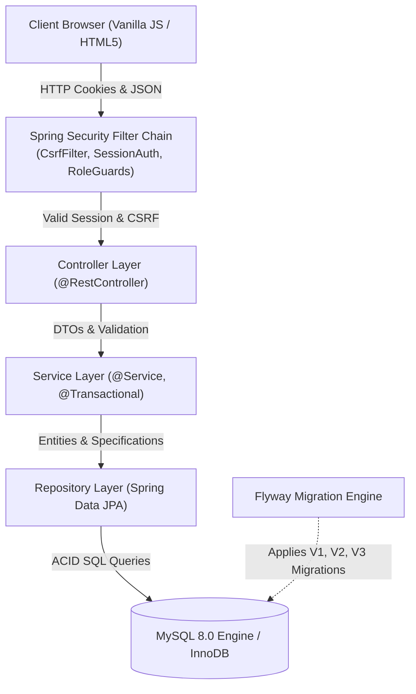

# ShopSphere — Full-Stack E-commerce & Inventory Management Platform

ShopSphere is an enterprise-grade full-stack e-commerce and inventory management application built with **Spring Boot 3.4**, **Java 21/24**, **Spring Security**, **Spring Data JPA / Hibernate**, **MySQL 8.0**, **Flyway Migrations**, and **Vanilla ES6 JavaScript**, designed with strict layered architecture, zero client-side pricing trust, session-based security, and professional REST API standards.

---

## 1. High-Level Architecture



---

## 2. Tech Stack

- **Backend**: Java 21 LTS (`--release 21`), Spring Boot 3.4.3, Spring Web, Spring Security, Spring Data JPA, Hibernate 6.6, Jakarta Bean Validation.
- **Database**: MySQL 8.0 (InnoDB engine), Flyway migrations.
- **Frontend**: HTML5, CSS3 Modern Design System, Vanilla ES6 JavaScript (zero SPA frameworks).
- **Security**: Spring Security session-based auth, BCrypt password hashing (strength 12), Cookie-based CSRF protection (`XSRF-TOKEN`), Role-based access control (`ROLE_CUSTOMER`, `ROLE_ADMIN`).
- **Testing**: JUnit 5, Mockito, Spring Boot Test, MockMvc, Spring Security Test, AssertJ, H2 in-memory test database.
- **API Documentation**: Springdoc OpenAPI 3.0 / Swagger UI (`/swagger-ui.html`).
- **Build Tool**: Maven 3.9+.

---

## 3. Implemented REST APIs

### Authentication & Current User (`/api/auth`)
| Method | Endpoint | Description | Role / Auth | Status Code |
|---|---|---|---|---|
| `POST` | `/api/auth/register` | Register customer account (BCrypt hash, default `ROLE_CUSTOMER`) | Anonymous | `201 Created` / `400` / `409` |
| `POST` | `/api/auth/login` | Authenticate credentials and establish HTTP session cookie | Anonymous | `200 OK` / `401 Unauthorized` |
| `POST` | `/api/auth/logout` | Invalidate session and clear SecurityContext | Authenticated | `200 OK` |
| `GET` | `/api/auth/me` | Retrieve profile of authenticated user | Authenticated | `200 OK` / `401 Unauthorized` |
| `GET` | `/api/auth/csrf` | Initialize and provide CSRF token | Anonymous | `200 OK` |

### Product Catalog APIs (`/api/products`)
| Method | Endpoint | Description | Role / Auth | Status Code |
|---|---|---|---|---|
| `GET` | `/api/products` | Paginated product browsing with query, category, price, and stock filters | Anonymous | `200 OK` |
| `GET` | `/api/products/{id}` | Get product by numeric ID | Anonymous | `200 OK` / `404` |
| `GET` | `/api/products/slug/{slug}` | Get product by SEO URL slug | Anonymous | `200 OK` / `404` |
| `GET` | `/api/products/sku/{sku}` | Get product by unique SKU | Anonymous | `200 OK` / `404` |
| `GET` | `/api/products/low-stock` | Get products where stock $\le$ threshold | Anonymous | `200 OK` |
| `POST` | `/api/products` | Create product (validates unique SKU/slug, positive prices) | `ROLE_ADMIN` | `201 Created` / `400` / `403` / `409` |
| `PUT` | `/api/products/{id}` | Update product details | `ROLE_ADMIN` | `200 OK` / `400` / `403` / `404` / `409` |
| `DELETE` | `/api/products/{id}` | Soft-deactivate product (`isActive = false`) | `ROLE_ADMIN` | `204 No Content` / `403` / `404` |

### Category APIs (`/api/categories`)
| Method | Endpoint | Description | Role / Auth | Status Code |
|---|---|---|---|---|
| `GET` | `/api/categories` | Flat list of active categories | Anonymous | `200 OK` |
| `GET` | `/api/categories/hierarchy` | Root categories with nested subcategories | Anonymous | `200 OK` |
| `GET` | `/api/categories/{id}` | Get category by ID | Anonymous | `200 OK` / `404` |
| `POST` | `/api/categories` | Create category (auto slug, uniqueness checks) | `ROLE_ADMIN` | `201 Created` / `400` / `403` / `409` |
| `PUT` | `/api/categories/{id}` | Update category | `ROLE_ADMIN` | `200 OK` / `400` / `403` / `404` / `409` |
| `DELETE` | `/api/categories/{id}` | Soft-deactivate category | `ROLE_ADMIN` | `204 No Content` / `403` / `404` |

---

## 4. Local Setup & Execution

### Prerequisites
- JDK 21 or 24 installed
- Apache Maven 3.9+
- MySQL 8.0 Server running on port 3306

### Database Setup
Flyway automatically creates the schema and seed data when starting with the `dev` profile:
```sql
CREATE DATABASE IF NOT EXISTS shopsphere_db CHARACTER SET utf8mb4 COLLATE utf8mb4_unicode_ci;
```

### Running the Application
```bash
# Run with local MySQL dev profile
mvn spring-boot:run "-Dspring-boot.run.profiles=dev"
```

### Development Demo Accounts
- **Administrator**: `admin@shopsphere.com` / `Admin@12345` (Role: `ROLE_ADMIN`)
- **Customer Registration**: Visit `http://localhost:8080/register.html` to register a new customer account (Role: `ROLE_CUSTOMER`).

### Web Interface & Documentation URLs
- **Storefront Home**: [http://localhost:8080/index.html](http://localhost:8080/index.html)
- **Product Details Page**: [http://localhost:8080/product.html?id=1](http://localhost:8080/product.html?id=1)
- **Sign In Page**: [http://localhost:8080/login.html](http://localhost:8080/login.html)
- **Registration Page**: [http://localhost:8080/register.html](http://localhost:8080/register.html)
- **Interactive Swagger UI**: [http://localhost:8080/swagger-ui.html](http://localhost:8080/swagger-ui.html)
- **OpenAPI 3.0 JSON**: [http://localhost:8080/v3/api-docs](http://localhost:8080/v3/api-docs)

### Executing Automated Tests
```bash
# Run all 67 unit, integration, validation, repository, and security tests
mvn clean test
```

---

## 5. Security Architecture & Full-Stack Concepts for Interviews

1. **Authentication vs Authorization**:
   - **Authentication (AuthN)**: Answering *"Who are you?"* by verifying credentials (email + BCrypt password hash).
   - **Authorization (AuthZ)**: Answering *"What are you allowed to do?"* by checking roles (`ROLE_CUSTOMER` vs `ROLE_ADMIN`) on requested endpoints.
2. **Session-Based Authentication for Monoliths**:
   - Uses standard, browser-native `JSESSIONID` cookies with `HttpOnly`, `SameSite=Lax`, and session fixation protection (`migrateSession()`).
   - Immunizes the frontend from token storage attacks (unlike storing JWTs in `localStorage` which is vulnerable to XSS).
3. **Cookie-Based CSRF Protection**:
   - Configured via `CookieCsrfTokenRepository.withHttpOnlyFalse()`.
   - Generates an `XSRF-TOKEN` cookie that the frontend Vanilla JS client reads and attaches as the `X-XSRF-TOKEN` request header on mutating requests (`POST`, `PUT`, `DELETE`).
4. **BCrypt Password Hashing**:
   - One-way adaptive cryptographic hashing with configurable work factor (12 salt rounds), resistant to rainbow-table and GPU brute-force attacks.
5. **Dynamic JPA Specifications & Database-Level Pagination**:
   - Rather than loading all rows into Java memory and filtering with streams, `ProductSpecification` builds dynamic SQL `WHERE` clauses at runtime using JPA `CriteriaBuilder`.
   - Uses SQL `LEFT JOIN` on `category` and `parent` so filtering by a root category automatically retrieves items belonging to nested subcategories without omitting records where parent is null.
   - Database-level pagination (`PageRequest.of(page, size, sort)`) translates to MySQL `LIMIT ? OFFSET ?` queries, maintaining $O(1)$ memory consumption on the server.
6. **Frontend State & URL Synchronization**:
   - The Vanilla JS catalog manager (`catalog.js`) maintains state across search queries, category selections, price ranges, stock flags, sorting, and pagination.
   - Synchronizes filter state via `window.history.replaceState()`, enabling bookmarking, browser back/forward navigation, and smooth reloads without page-reload flashes.
