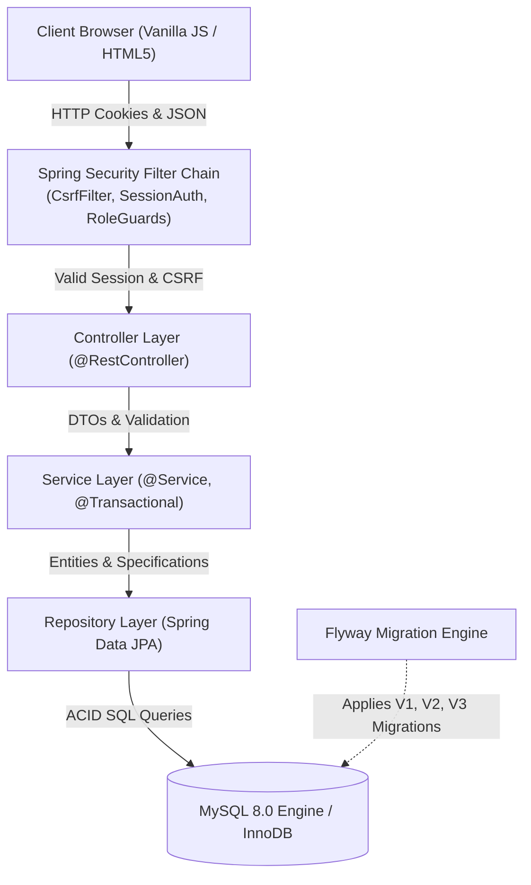

# ShopSphere — Full-Stack E-commerce & Inventory Management Platform

ShopSphere is an enterprise-grade full-stack e-commerce and inventory management application built with **Spring Boot 3.4**, **Java 21/24**, **Spring Security**, **Spring Data JPA / Hibernate**, **MySQL 8.0**, **Flyway Migrations**, and **Vanilla ES6 JavaScript**, designed with strict layered architecture, zero client-side pricing trust, session-based security, and professional REST API standards.

---

## 1. High-Level Architecture



---

## 2. Tech Stack

- **Backend**: Java 21 LTS (`--release 21`), Spring Boot 3.4.3, Spring Web, Spring Security, Spring Data JPA, Hibernate 6.6, Jakarta Bean Validation.
- **Database**: MySQL 8.0 (InnoDB engine), Flyway migrations.
- **Frontend**: HTML5, CSS3 Modern Design System, Vanilla ES6 JavaScript (zero SPA frameworks).
- **Security**: Spring Security session-based auth, BCrypt password hashing (strength 12), Cookie-based CSRF protection (`XSRF-TOKEN`), Role-based access control (`ROLE_CUSTOMER`, `ROLE_ADMIN`).
- **Testing**: JUnit 5, Mockito, Spring Boot Test, MockMvc, Spring Security Test, AssertJ, H2 in-memory test database.
- **API Documentation**: Springdoc OpenAPI 3.0 / Swagger UI (`/swagger-ui.html`).
- **Build Tool**: Maven 3.9+.

---

## 3. Implemented REST APIs

### Authentication & Current User (`/api/auth`)
| Method | Endpoint | Description | Role / Auth | Status Code |
|---|---|---|---|---|
| `POST` | `/api/auth/register` | Register customer account (BCrypt hash, default `ROLE_CUSTOMER`) | Anonymous | `201 Created` / `400` / `409` |
| `POST` | `/api/auth/login` | Authenticate credentials and establish HTTP session cookie | Anonymous | `200 OK` / `401 Unauthorized` |
| `POST` | `/api/auth/logout` | Invalidate session and clear SecurityContext | Authenticated | `200 OK` |
| `GET` | `/api/auth/me` | Retrieve profile of authenticated user | Authenticated | `200 OK` / `401 Unauthorized` |
| `GET` | `/api/auth/csrf` | Initialize and provide CSRF token | Anonymous | `200 OK` |

### Product Catalog APIs (`/api/products`)
| Method | Endpoint | Description | Role / Auth | Status Code |
|---|---|---|---|---|
| `GET` | `/api/products` | Paginated product browsing with query, category, price, and stock filters | Anonymous | `200 OK` |
| `GET` | `/api/products/{id}` | Get product by numeric ID | Anonymous | `200 OK` / `404` |
| `GET` | `/api/products/slug/{slug}` | Get product by SEO URL slug | Anonymous | `200 OK` / `404` |
| `GET` | `/api/products/sku/{sku}` | Get product by unique SKU | Anonymous | `200 OK` / `404` |
| `GET` | `/api/products/low-stock` | Get products where stock $\le$ threshold | Anonymous | `200 OK` |
| `POST` | `/api/products` | Create product (validates unique SKU/slug, positive prices) | `ROLE_ADMIN` | `201 Created` / `400` / `403` / `409` |
| `PUT` | `/api/products/{id}` | Update product details | `ROLE_ADMIN` | `200 OK` / `400` / `403` / `404` / `409` |
| `DELETE` | `/api/products/{id}` | Soft-deactivate product (`isActive = false`) | `ROLE_ADMIN` | `204 No Content` / `403` / `404` |

### Category APIs (`/api/categories`)
| Method | Endpoint | Description | Role / Auth | Status Code |
|---|---|---|---|---|
| `GET` | `/api/categories` | Flat list of active categories | Anonymous | `200 OK` |
| `GET` | `/api/categories/hierarchy` | Root categories with nested subcategories | Anonymous | `200 OK` |
| `GET` | `/api/categories/{id}` | Get category by ID | Anonymous | `200 OK` / `404` |
| `POST` | `/api/categories` | Create category (auto slug, uniqueness checks) | `ROLE_ADMIN` | `201 Created` / `400` / `403` / `409` |
| `PUT` | `/api/categories/{id}` | Update category | `ROLE_ADMIN` | `200 OK` / `400` / `403` / `404` / `409` |
| `DELETE` | `/api/categories/{id}` | Soft-deactivate category | `ROLE_ADMIN` | `204 No Content` / `403` / `404` |

### Shopping Cart APIs (`/api/cart`)
| Method | Endpoint | Description | Role / Auth | Status Code |
|---|---|---|---|---|
| `GET` | `/api/cart` | Get authenticated customer's cart with recalculations | `ROLE_CUSTOMER` | `200 OK` / `401` |
| `POST` | `/api/cart/items` | Add product to cart (validates active product & stock) | `ROLE_CUSTOMER` | `200 OK` / `400` / `404` |
| `PATCH` | `/api/cart/items/{itemId}` | Update cart item quantity (stepper adjustment) | `ROLE_CUSTOMER` | `200 OK` / `400` / `404` |
| `DELETE` | `/api/cart/items/{itemId}` | Remove specific item from cart | `ROLE_CUSTOMER` | `200 OK` / `404` |
| `DELETE` | `/api/cart/items` | Clear all items from cart | `ROLE_CUSTOMER` | `200 OK` |

### Customer Address APIs (`/api/addresses`)
| Method | Endpoint | Description | Role / Auth | Status Code |
|---|---|---|---|---|
| `GET` | `/api/addresses` | Get saved shipping addresses for authenticated user | `ROLE_CUSTOMER` | `200 OK` / `401` |
| `POST` | `/api/addresses` | Add new shipping address with validation | `ROLE_CUSTOMER` | `201 Created` / `400` |
| `GET` | `/api/addresses/{id}` | Get specific address (user isolated) | `ROLE_CUSTOMER` | `200 OK` / `404` |

### Checkout & Order Management APIs (`/api/orders`)
| Method | Endpoint | Description | Role / Auth | Status Code |
|---|---|---|---|---|
| `POST` | `/api/orders/checkout` | Concurrency-safe checkout with pessimistic locking & simulated payment | `ROLE_CUSTOMER` | `201 Created` / `400` |
| `GET` | `/api/orders/my` | Paginated order history for authenticated customer | `ROLE_CUSTOMER` | `200 OK` / `401` |
| `GET` | `/api/orders/{id}` | Get order details by ID (user isolated) | `ROLE_CUSTOMER` | `200 OK` / `404` |
| `GET` | `/api/orders/number/{orderNumber}` | Get order details by public tracking number | `ROLE_CUSTOMER` | `200 OK` / `404` |

### Admin Dashboard & Analytics APIs (`/api/admin/dashboard` & `/api/admin/reports`)
| Method | Endpoint | Description | Role / Auth | Status Code |
|---|---|---|---|---|
| `GET` | `/api/admin/dashboard` | Period summary KPIs (revenue, profit, orders, low-stock count) | `ROLE_ADMIN` | `200 OK` / `401` / `403` |
| `GET` | `/api/admin/dashboard/sales` | Continuous daily sales, revenue, profit, and order timeline | `ROLE_ADMIN` | `200 OK` / `401` / `403` |
| `GET` | `/api/admin/dashboard/top-products` | Top-selling products ranked by units sold and revenue | `ROLE_ADMIN` | `200 OK` / `401` / `403` |
| `GET` | `/api/admin/reports/categories` | Category sales, unit volume, and profitability report | `ROLE_ADMIN` | `200 OK` / `401` / `403` |
| `GET` | `/api/admin/reports/inventory` | Warehouse asset valuation (cost vs retail, unrealized profit) | `ROLE_ADMIN` | `200 OK` / `401` / `403` |

### Admin Inventory Management APIs (`/api/admin/inventory`)
| Method | Endpoint | Description | Role / Auth | Status Code |
|---|---|---|---|---|
| `GET` | `/api/admin/inventory` | Paginated product stock levels with search and low-stock filter | `ROLE_ADMIN` | `200 OK` / `401` / `403` |
| `GET` | `/api/admin/inventory/low-stock` | Products at or below their reorder threshold | `ROLE_ADMIN` | `200 OK` / `401` / `403` |
| `PATCH` | `/api/admin/inventory/products/{id}/threshold` | Configure low-stock alert threshold | `ROLE_ADMIN` | `200 OK` / `400` / `403` / `404` |
| `POST` | `/api/admin/inventory/restock` | Restock inventory with pessimistic locking & audit logging | `ROLE_ADMIN` | `200 OK` / `400` / `403` / `404` |
| `POST` | `/api/admin/inventory/adjustments` | Manual stock adjustment (positive/negative) with mandatory reason | `ROLE_ADMIN` | `200 OK` / `400` / `403` / `404` |
| `GET` | `/api/admin/inventory/movements` | Paginated audit log of all historical inventory movements | `ROLE_ADMIN` | `200 OK` / `401` / `403` |

### Admin Order Management APIs (`/api/admin/orders`)
| Method | Endpoint | Description | Role / Auth | Status Code |
|---|---|---|---|---|
| `GET` | `/api/admin/orders` | Paginated order search with status, order number, and date range filters | `ROLE_ADMIN` | `200 OK` / `401` / `403` |
| `GET` | `/api/admin/orders/{id}` | Order details including cost snapshot breakdown & gross profit | `ROLE_ADMIN` | `200 OK` / `401` / `403` / `404` |
| `PATCH` | `/api/admin/orders/{id}/status` | Lifecycle status transition (`CONFIRMED` $\to$ `SHIPPED` $\to$ `DELIVERED`, or `CANCELLED` with auto inventory restoration) | `ROLE_ADMIN` | `200 OK` / `400` / `403` / `404` |

---

## 4. Local Setup & Execution

### Prerequisites
- JDK 21 or 24 installed
- Apache Maven 3.9+
- MySQL 8.0 Server running on port 3306

### Database Setup
Flyway automatically creates the schema and seed data when starting with the `dev` profile:
```sql
CREATE DATABASE IF NOT EXISTS shopsphere_db CHARACTER SET utf8mb4 COLLATE utf8mb4_unicode_ci;
```

### Running the Application
```bash
# Run with local MySQL dev profile
mvn spring-boot:run "-Dspring-boot.run.profiles=dev"
```

### Development Demo Accounts
- **Administrator**: `admin@shopsphere.com` / `Admin@12345` (Role: `ROLE_ADMIN`)
- **Customer Registration**: Visit `http://localhost:8080/register.html` to register a new customer account (Role: `ROLE_CUSTOMER`).

### Web Interface & Documentation URLs
- **Storefront Catalog**: [http://localhost:8080/index.html](http://localhost:8080/index.html)
- **Product Details Page**: [http://localhost:8080/product.html?id=1](http://localhost:8080/product.html?id=1)
- **Shopping Cart**: [http://localhost:8080/cart.html](http://localhost:8080/cart.html)
- **Secure Checkout**: [http://localhost:8080/checkout.html](http://localhost:8080/checkout.html)
- **Order Confirmation**: [http://localhost:8080/order-confirmation.html](http://localhost:8080/order-confirmation.html)
- **Customer Orders**: [http://localhost:8080/orders.html](http://localhost:8080/orders.html)
- **Administrative Portal**: [http://localhost:8080/admin.html](http://localhost:8080/admin.html) *(Requires `ROLE_ADMIN`)*
- **Sign In Page**: [http://localhost:8080/login.html](http://localhost:8080/login.html)
- **Registration Page**: [http://localhost:8080/register.html](http://localhost:8080/register.html)
- **Interactive Swagger UI**: [http://localhost:8080/swagger-ui.html](http://localhost:8080/swagger-ui.html)
- **OpenAPI 3.0 JSON**: [http://localhost:8080/v3/api-docs](http://localhost:8080/v3/api-docs)

### Executing Automated Tests
```bash
# Run all 128 unit, integration, validation, repository, concurrency, and security tests
mvn clean test
```

---

## 5. Security & Architectural Interview Concepts

1. **Historical Cost Snapshots for Deterministic Gross Profit**:
   - Product supplier cost prices fluctuate over time. Calculating gross profit using live product cost would distort historical accounting.
   - ShopSphere takes a snapshot of `costPrice` on `order_items.unit_cost_snapshot` during checkout. Estimated gross profit is calculated deterministically as $\sum (\text{lineTotal} - (\text{unitCostSnapshot} \times \text{quantity}))$, accurately insulating past reporting from future supplier price fluctuations.
2. **Order Lifecycle State Machine & Automated Inventory Restoration**:
   - Status transitions follow a strict directed state graph: `PENDING` $\to$ `CONFIRMED` $\to$ `SHIPPED` $\to$ `DELIVERED`. `DELIVERED` and `CANCELLED` are terminal states.
   - If an order is cancelled from `PENDING` or `CONFIRMED`, inventory is automatically restored using pessimistic row locks (`findByIdWithPessimisticLock`), and an `ORDER_CANCELLED_RESTORE` audit log is created.
3. **Pessimistic Row Locking (`SELECT ... FOR UPDATE`) vs Optimistic Locking**:
   - In high-concurrency e-commerce scenarios where stock is low (e.g. flash sales), optimistic locking (`@Version`) causes high transaction rollback rates when multiple users attempt to purchase the last unit simultaneously.
   - ShopSphere implements `@Lock(LockModeType.PESSIMISTIC_WRITE)` on `ProductRepository.findAllByIdInWithPessimisticLock()`. At the database engine level (MySQL InnoDB), this acquires exclusive row locks (`SELECT ... FOR UPDATE`), forcing concurrent transactions to serialize, verifying real-time stock, and preventing negative stock or overselling.
4. **Transaction Rollback On Payment Failure**:
   - Checkout is wrapped in `@Transactional(rollbackFor = Exception.class)`. When payment simulation fails (simulated card rejection), `PaymentFailedException` is thrown.
   - Spring Transaction Manager intercepts this unchecked exception and rolls back all database operations within the transaction: inventory deduction is undone, cart items remain intact, and no corrupt or partial order record is committed.
5. **Zero Client Trust & Financial Precision**:
   - Frontend clients never send prices, discounts, taxes, or order totals. All calculations are strictly executed server-side using `BigDecimal` with `RoundingMode.HALF_UP` and stored in `DECIMAL(12, 2)` columns, avoiding IEEE 754 floating-point inaccuracies.
6. **Continuous Time-Series Aggregation Without Chart Skew**:
   - In time-series charts, database `GROUP BY` only returns dates with orders, leaving missing days. If plotted directly, a gap between Monday and Friday appears continuous.
   - ShopSphere's analytics service pre-populates every date in the requested range with zero-value objects before accumulating order totals, ensuring visually honest, continuous charts.
7. **Idempotency in Payment & Checkout**:
   - The frontend generates a unique UUID `idempotencyKey` per checkout session. If network lag causes duplicate form submissions or retries, the server detects the existing key for that customer and returns the original order confirmation without duplicate charges or double inventory reduction.
8. **Session-Based Authentication for Monoliths & CSRF Protection**:
   - Uses standard, browser-native `JSESSIONID` cookies with `HttpOnly`, `SameSite=Lax`, and session fixation protection (`migrateSession()`).
   - Cookie-based CSRF protection is configured via `CookieCsrfTokenRepository.withHttpOnlyFalse()`. The client reads `XSRF-TOKEN` and sends it as `X-XSRF-TOKEN` on mutating HTTP methods (`POST`, `PUT`, `PATCH`, `DELETE`). All `/api/admin/**` endpoints strictly require `ROLE_ADMIN`.

