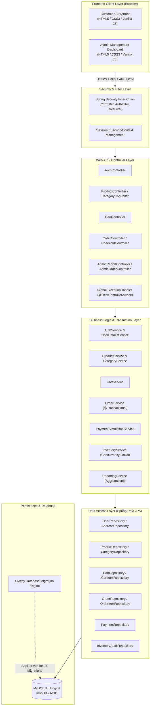
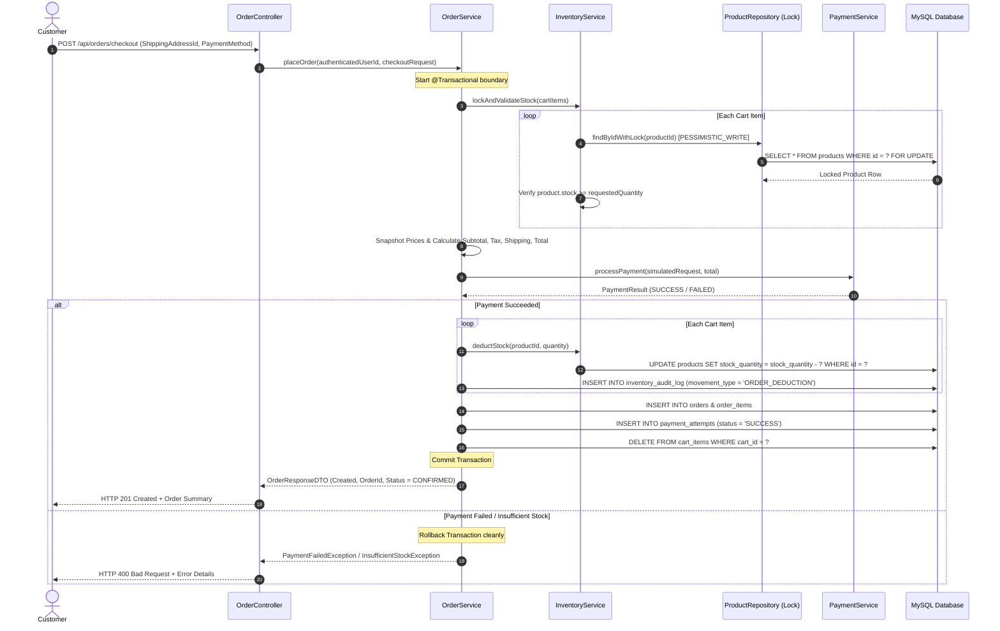

# ShopSphere — Architecture & System Design Document

## 1. High-Level Architecture Overview

ShopSphere uses a modular, layered monolithic architecture built on Spring Boot 3.4+ and Java 21/24. This pattern is ideal for enterprise reliability, high transactional consistency, and straightforward deployment.

### System Architecture Diagram



---

## 2. Layered Responsibilities

1. **Controller Layer (`com.shopsphere.controller`)**:
   - Accepts HTTP requests, parses headers and query/path params.
   - Validates incoming DTOs using `@Valid` and Bean Validation annotations.
   - Delegates business execution to appropriate Service classes.
   - Maps Service outputs into well-defined Response DTOs and HTTP status codes (`200 OK`, `201 Created`, `204 No Content`).
   - Never accesses database entities or repositories directly.

2. **Service Layer (`com.shopsphere.service`)**:
   - Enforces all business rules (stock threshold checks, status transition legality, price calculations, order snapshotting).
   - Manages transactional boundaries using `@Transactional(rollbackFor = Exception.class)`.
   - Protects against concurrency hazards (race conditions on stock updates).
   - Maps between Entities and DTOs.
   - Audits critical mutations (inventory ledger logs).

3. **Repository Layer (`com.shopsphere.repository`)**:
   - Extends `JpaRepository<Entity, ID>` for standard CRUD operations.
   - Defines custom Spring Data query methods and `@Query` JPQL/native queries for complex joins and aggregations.
   - Declares concurrency locks using `@Lock(LockModeType.PESSIMISTIC_WRITE)` for inventory allocations.

4. **Database Layer (MySQL InnoDB)**:
   - Foreign key constraints maintain referential integrity.
   - Table-level checks and unique indexes ensure zero duplicate emails, usernames, or SKUs.
   - InnoDB transactional isolation ensures ACID guarantees.

---

## 3. Package Structure

```
d:\ShopSphere1\
├── pom.xml
├── mvnw / mvnw.cmd
├── AGENTS.md
├── docs/
│   ├── requirements.md
│   ├── architecture.md
│   ├── database-design.md
│   ├── api-reference.md
│   ├── test-plan.md
│   ├── deployment.md
│   └── implementation-status.md
└── src/
    ├── main/
    │   ├── java/com/shopsphere/
    │   │   ├── ShopSphereApplication.java
    │   │   ├── config/              # SecurityConfig, WebConfig, SwaggerConfig, AuditConfig
    │   │   ├── security/            # CustomUserDetailsService, UserPrincipal, SecurityUtils
    │   │   ├── controller/          # Storefront & Admin REST Controllers
    │   │   ├── dto/                 # Request & Response DTOs grouped by domain
    │   │   │   ├── auth/
    │   │   │   ├── product/
    │   │   │   ├── cart/
    │   │   │   ├── order/
    │   │   │   ├── admin/
    │   │   │   └── common/          # ApiResponse, PageResponse, ErrorResponse
    │   │   ├── entity/              # JPA Persistence Entities & Enums
    │   │   ├── repository/          # Spring Data JPA Repositories
    │   │   ├── service/             # Service Interfaces & Implementations
    │   │   ├── exception/           # Custom Domain Exceptions & GlobalExceptionHandler
    │   │   └── validation/          # Custom validators (e.g. UniqueSku, ValidEnum)
    │   └── resources/
    │       ├── application.yml      # Base Spring Boot configuration
    │       ├── application-dev.yml  # Local dev MySQL profile
    │       ├── application-prod.yml # Production environment profile
    │       ├── db/migration/        # Flyway SQL migration scripts (V1, V2, etc.)
    │       └── static/              # Storefront & Admin Frontend UI
    │           ├── css/             # Modern CSS stylesheets (styles, admin, theme)
    │           ├── js/              # Vanilla ES6 modules (api, auth, cart, admin, app)
    │           └── *.html           # Storefront pages (index, catalog, product, cart, checkout, orders, admin)
    └── test/
        ├── java/com/shopsphere/
        │   ├── controller/          # MockMvc Controller integration tests
        │   ├── service/             # Unit tests using Mockito
        │   ├── repository/          # DataJpaTest repository tests
        │   └── security/            # Authentication & authorization policy tests
        └── resources/
            └── application-test.yml # In-memory H2 / test database config
```

---

## 4. Security Architecture

### Authentication & Authorization Strategy
- **Authentication**: HTTP Session with `SecurityContextPersistenceFilter` and secure HTTP-only session cookies.
  - Why this strategy: For a unified same-origin web application, HTTP Sessions are browser-native, standard, immune to localStorage XSS token theft, and provide immediate revocation upon logout.
- **Password Protection**: Passwords hashed using `BCryptPasswordEncoder` (cost factor 12).
- **Roles & Permissions**:
  - `ROLE_CUSTOMER`: Can place orders, manage personal cart, addresses, reviews, and view own order history.
  - `ROLE_ADMIN`: Access to `/api/admin/**` endpoints, product CRUD, inventory updates, status management, customer directory, and financial reports.
- **CSRF Defense**: Enabled for all state-mutating requests (`POST`, `PUT`, `DELETE`, `PATCH`). CSRF tokens served in cookies/headers using `CookieCsrfTokenRepository.withHttpOnlyFalse()`.
- **Customer Data Isolation**:
  - All customer order/cart/address operations resolve the authenticated user ID from `SecurityContextHolder`. Customers can never specify an arbitrary `userId` to inspect or manipulate another user's data.

---

## 5. Transaction & Concurrency Management

### Order Placement Sequence



---

## 6. Centralized Error Handling Model

Every API error conforms to a unified structure:
```json
{
  "timestamp": "2026-10-14T21:30:00Z",
  "status": 400,
  "error": "Bad Request",
  "message": "Insufficient stock for product: Wireless Noise-Cancelling Headphones",
  "path": "/api/orders/checkout",
  "validationErrors": [
    {
      "field": "quantity",
      "rejectedValue": 15,
      "reason": "Requested quantity exceeds available stock (max: 4)"
    }
  ]
}
```
All errors are trapped by `GlobalExceptionHandler` mapping:
- `MethodArgumentNotValidException` → `400 Bad Request` with field breakdown
- `ResourceNotFoundException` → `404 Not Found`
- `InsufficientStockException` → `409 Conflict`
- `InvalidStatusTransitionException` → `400 Bad Request`
- `AccessDeniedException` → `403 Forbidden`
- `AuthenticationException` → `401 Unauthorized`
- General `Exception` → `500 Internal Server Error` (with secure sanitized message)
