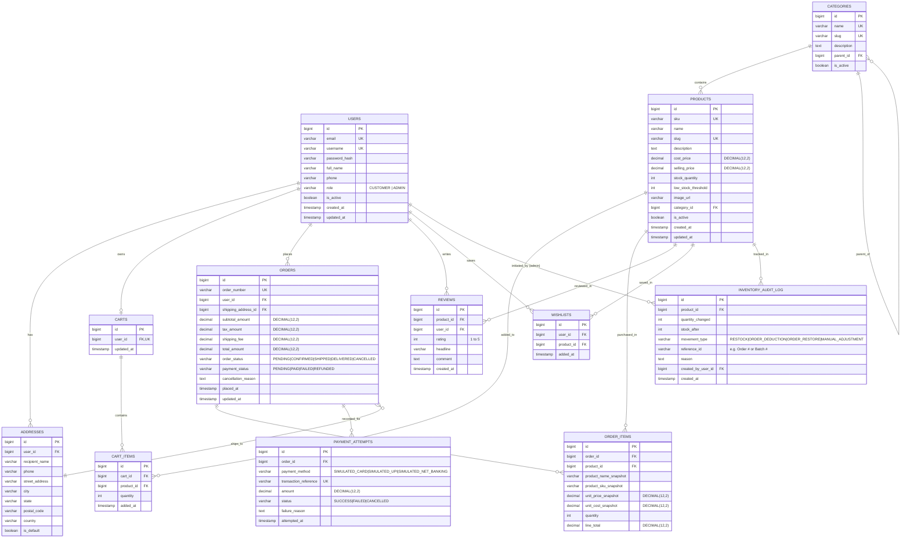

# ShopSphere — Database Design & Data Dictionary

## 1. Entity-Relationship (ER) Diagram

---

## 2. Detailed Data Dictionary

### Table: `users`
| Column | Type | Nullable | Key | Constraints & Description |
|---|---|---|---|---|
| `id` | BIGINT AUTO_INCREMENT | No | PK | Primary Key |
| `email` | VARCHAR(150) | No | UK | Normalized lower-case, unique index |
| `username` | VARCHAR(60) | No | UK | Unique display username |
| `password_hash` | VARCHAR(255) | No | - | BCrypt hashed password |
| `full_name` | VARCHAR(120) | No | - | Customer full legal name |
| `phone` | VARCHAR(25) | Yes | - | Customer contact phone number |
| `role` | VARCHAR(20) | No | - | `ROLE_CUSTOMER`, `ROLE_ADMIN` |
| `is_active` | BOOLEAN | No | - | Default `TRUE`; used for account deactivation |
| `created_at` | TIMESTAMP | No | - | Audit timestamp |
| `updated_at` | TIMESTAMP | No | - | Audit timestamp |

### Table: `addresses`
| Column | Type | Nullable | Key | Constraints & Description |
|---|---|---|---|---|
| `id` | BIGINT AUTO_INCREMENT | No | PK | Primary Key |
| `user_id` | BIGINT | No | FK | References `users(id)` ON DELETE CASCADE |
| `recipient_name` | VARCHAR(120) | No | - | Receiver name |
| `phone` | VARCHAR(25) | No | - | Delivery phone |
| `street_address` | VARCHAR(255) | No | - | Street & apartment/suite details |
| `city` | VARCHAR(100) | No | - | City name |
| `state` | VARCHAR(100) | No | - | State / Province |
| `postal_code` | VARCHAR(20) | No | - | Postal / ZIP code |
| `country` | VARCHAR(100) | No | - | ISO country or standard name |
| `is_default` | BOOLEAN | No | - | Default shipping address flag |

### Table: `categories`
| Column | Type | Nullable | Key | Constraints & Description |
|---|---|---|---|---|
| `id` | BIGINT AUTO_INCREMENT | No | PK | Primary Key |
| `name` | VARCHAR(100) | No | UK | Unique category display name |
| `slug` | VARCHAR(120) | No | UK | SEO URL slug (e.g. `smartphones-accessories`) |
| `description` | TEXT | Yes | - | Detailed category overview |
| `parent_id` | BIGINT | Yes | FK | Self-referencing FK for subcategories |
| `is_active` | BOOLEAN | No | - | Default `TRUE` |

### Table: `products`
| Column | Type | Nullable | Key | Constraints & Description |
|---|---|---|---|---|
| `id` | BIGINT AUTO_INCREMENT | No | PK | Primary Key |
| `sku` | VARCHAR(64) | No | UK | Stock Keeping Unit (e.g. `ELEC-AUD-001`) |
| `name` | VARCHAR(200) | No | - | Full product title |
| `slug` | VARCHAR(220) | No | UK | URL-safe slug |
| `description` | TEXT | Yes | - | Detailed product specifications and copy |
| `cost_price` | DECIMAL(12,2) | No | - | Acquisition cost used for gross margin calculations |
| `selling_price`| DECIMAL(12,2) | No | - | Retail customer purchase price |
| `stock_quantity`| INT | No | - | Current inventory quantity available (>= 0) |
| `low_stock_threshold`| INT | No | - | Triggers admin dashboard restock alert (default 5) |
| `image_url` | VARCHAR(500) | Yes | - | Primary product showcase image |
| `category_id` | BIGINT | No | FK | References `categories(id)` |
| `is_active` | BOOLEAN | No | - | Soft-delete flag; inactive products cannot be ordered |
| `created_at` | TIMESTAMP | No | - | Audit timestamp |
| `updated_at` | TIMESTAMP | No | - | Audit timestamp |

### Table: `carts` & `cart_items`
- `carts`: One-to-one with `users`. Represents an authenticated user's active shopping cart session.
- `cart_items`: Holds `product_id`, `quantity`, and timestamp. Unique composite key on `(cart_id, product_id)`.

### Table: `orders` & `order_items`
- `orders`:
  - `order_number`: Unique alphanumeric reference code (e.g., `ORD-20261014-9X8K`).
  - `user_id`: FK to `users(id)`.
  - `shipping_address_id`: FK to `addresses(id)`.
  - Monetary values: `subtotal_amount`, `tax_amount`, `shipping_fee`, `total_amount` all `DECIMAL(12,2)`.
  - Statuses: `order_status` (`PENDING`, `CONFIRMED`, `SHIPPED`, `DELIVERED`, `CANCELLED`).
- `order_items`:
  - **Crucial Requirement**: Snapshots the historical product state!
  - `product_name_snapshot`: Stores product name at the moment of order.
  - `product_sku_snapshot`: Stores SKU at the moment of order.
  - `unit_price_snapshot`: Exact price charged (`DECIMAL(12,2)`).
  - `unit_cost_snapshot`: Exact cost price at purchase time (`DECIMAL(12,2)`) for historical profit analytics.
  - `quantity`: Quantity purchased.
  - `line_total`: `unit_price_snapshot * quantity`.

### Table: `payment_attempts`
- Records payment simulations (`SUCCESS`, `FAILED`, `CANCELLED`), transaction reference, payment method, and amount.

### Table: `inventory_audit_log`
- Immutable ledger tracking every change in product stock.
- Movement types: `RESTOCK`, `ORDER_DEDUCTION`, `ORDER_CANCELLED_RESTORE`, `MANUAL_ADJUSTMENT`.
- Columns: `product_id`, `stock_before`, `quantity_changed`, `stock_after`, `movement_type`, `reference_id` (e.g. Order # or Batch #), `reason`, `user_id` (FK to `users`), `created_at`.

---

## 3. Indexing & Performance Strategy
1. **Primary & Unique Indexes**:
   - `users(email)`
   - `products(sku)`, `products(slug)`
   - `categories(slug)`
   - `orders(order_number)`
   - `payment_attempts(transaction_reference)`
2. **Foreign Key Performance Indexes**:
   - `idx_products_category`: `products(category_id)`
   - `idx_orders_user`: `orders(user_id)`
   - `idx_order_items_order`: `order_items(order_id)`
   - `idx_cart_items_cart`: `cart_items(cart_id)`
   - `idx_inventory_audit_product`: `inventory_audit_log(product_id)`
   - `idx_inventory_audit_user`: `inventory_audit_log(user_id)`
3. **Operational, Reporting & Filtering Indexes (V5 Migration)**:
   - `idx_products_active_stock`: `products(is_active, stock_quantity)` — for catalog and low-stock filters.
   - `idx_orders_status_created`: `orders(order_status, created_at)` — composite index accelerating admin date-range revenue aggregation and order status filtering.
   - `idx_inventory_audit_created`: `inventory_audit_log(created_at)` — index for fast chronological audit retrieval.
   - `idx_inventory_audit_movement`: `inventory_audit_log(movement_type)` — index for filtering stock adjustments vs supplier restocks.
